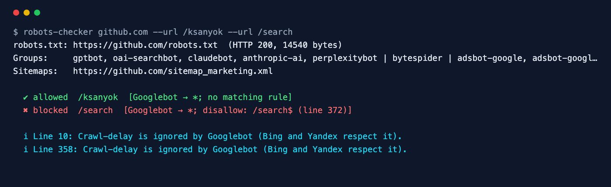

<div align="center">

# Robots.txt Checker

**Validate robots.txt and test any URL against it — exactly like Googlebot does.**

[](https://github.com/ksanyok/robots-checker/actions/workflows/ci.yml) [](LICENSE)   [](https://promopilot.link/en/tools/robots-checker.php?utm_source=github&utm_medium=repo&utm_campaign=tools&utm_content=robots-checker)

**[▶ Use the free online version — no install, no sign-up](https://promopilot.link/en/tools/robots-checker.php?utm_source=github&utm_medium=repo&utm_campaign=tools&utm_content=robots-checker)**

</div>

`robots-checker` downloads a site's `robots.txt`, parses it the way Google does (RFC 9309: user-agent groups, `*` and `$` wildcards, longest-match wins, `allow` wins ties) and answers the question that matters: *can this crawler fetch this URL, and which line decides it?* It also flags the mistakes that quietly cost traffic — `Disallow: /` left over from staging, blocked CSS and JS, HTML served instead of a text file, rules before any `User-agent`, relative sitemap URLs and files over Google's 500 KB limit.



## What it checks

- Whether a URL is allowed or blocked for a user agent — and the exact rule and line that decides it
- Group selection like Google: the most specific matching user-agent token, falling back to `*`; consecutive `User-agent` lines share one group
- `*` and `$` wildcards, longest-match precedence, `allow` winning ties, `/robots.txt` always allowed
- `Disallow: /` for everyone, Googlebot blocked from the home page, CSS/JS directories blocked from rendering
- Syntax: rules before any `User-agent`, unknown directives (`Noindex:`), paths without a leading `/`, malformed lines, relative `Sitemap:` URLs
- HTTP behaviour: 404 (everything allowed), 5xx (everything blocked), HTML served as robots.txt, wrong content type, files over 500 KB
- Crawl-delay and Yandex-only directives (`Host`, `Clean-param`) explained

## Why it matters

One line in robots.txt can remove a whole site from search. It happens more often than it should: a staging `Disallow: /` deployed to production, a CMS update that blocks `/wp-includes/` scripts so Google renders a broken page, a CDN that answers `/robots.txt` with the home page, or a server error that makes Google stop crawling entirely. Because nothing visibly breaks for visitors, these mistakes can go unnoticed for weeks while traffic declines. Testing your key URLs on every deploy catches them in seconds.

## Quick start

```bash
# run straight from GitHub, nothing to install
npx github:ksanyok/robots-checker example.com

# or install the CLI globally
npm install -g github:ksanyok/robots-checker
robots-checker example.com
```

Test specific URLs as Googlebot:

```bash
robots-checker example.com --url /blog/ --url /cart --url "/search?q=shoes"
```

Test as another crawler:

```bash
robots-checker example.com --ua Bingbot --url /private/
```

Check a local file before deploying it:

```bash
robots-checker --file public/robots.txt --url / --url /assets/app.js
```

## Example output

```text
$ robots-checker github.com --url /ksanyok --url /search
robots.txt: https://github.com/robots.txt  (HTTP 200, 14540 bytes)
Groups:     gptbot, oai-searchbot, claudebot, anthropic-ai, perplexitybot | bytespider | adsbot-google, adsbot-google-mobile | bingbot, adidxbot, bingpreview | baidu | *
Sitemaps:   https://github.com/sitemap_marketing.xml

  ✔ allowed  /ksanyok  [Googlebot → *; no matching rule]
  ✖ blocked  /search  [Googlebot → *; disallow: /search$ (line 372)]

  i Line 10: Crawl-delay is ignored by Googlebot (Bing and Yandex respect it).
  i Line 358: Crawl-delay is ignored by Googlebot (Bing and Yandex respect it).
```

## CLI

```text
Usage: robots-checker <site> [options]
       robots-checker --file robots.txt --url /private/page

Downloads <site>/robots.txt, validates it, flags SEO mistakes and tests
whether URLs may be crawled by a given user agent (RFC 9309 matching).

Options:
  -u, --url <path>   URL or path to test (repeatable)
  -a, --ua <agent>   User agent to test as (default: Googlebot)
  --file <path>      Analyse a local robots.txt instead of downloading one
  --json             Print the full report as JSON
  --strict           Exit with code 1 on warnings too
  -h, --help         Show this help

Online version (no install): https://promopilot.link/en/tools/robots-checker.php
```

## Use as a library

```js
import { checkRobots, parseRobots, isAllowed } from '@promopilot/robots-checker';

const report = await checkRobots('example.com', { urls: ['/', '/admin/'], userAgent: 'Googlebot' });
for (const t of report.tests) console.log(t.url, t.allowed, t.rule?.line);
console.log(report.sitemaps, report.issues);

// Offline: parse once, test many URLs
const robots = parseRobots(fs.readFileSync('robots.txt', 'utf8'));
isAllowed(robots, '/private/report.pdf', 'Bingbot'); // { allowed: false, rule: { type, path, line }, agent: '*' }
```

`checkRobots(site, { urls, userAgent, fetch })` returns `{ url, finalUrl, status, bytes, groups[], sitemaps[], tests[], issues[], ok }`. `isAllowed(parsed, url, userAgent)` is synchronous and fast enough to run over a full crawl list. Issue codes are stable (`blocks-everything`, `blocks-googlebot`, `blocks-resources`, `server-error`, `html-response`, `too-large`, `rule-before-agent`, …).

## Use in CI (GitHub Actions)

Fail a deploy if robots.txt would block your important pages:

```yaml
on: [push]
jobs:
  robots:
    runs-on: ubuntu-latest
    steps:
      - uses: actions/checkout@v4
      - uses: ksanyok/robots-checker@v1
        with:
          args: --file public/robots.txt --url / --url /blog/ --url /assets/app.js --strict
```

## How it works

The file is fetched with Node's built-in `fetch` (following redirects) and parsed line by line: comments and a UTF-8 BOM are stripped, field names are case-insensitive, and consecutive `User-agent` lines form a single group. To test a URL, the checker picks the group whose product token is the longest substring of the user agent (or `*`), turns each path pattern into a regular expression (`*` → any characters, trailing `$` → end of URL) and applies the longest matching rule, preferring `allow` on equal length — the precedence defined in RFC 9309 and used by Google.

## CLI vs. online version

| | This package | [Online tool](https://promopilot.link/en/tools/robots-checker.php?utm_source=github&utm_medium=repo&utm_campaign=tools&utm_content=robots-checker) |
|---|---|---|
| Runs on | Your machine, CI, deploy hooks | Any browser |
| Local files | Yes, `--file` before deploy | Published file only |
| URL tests | Any number, any user agent | Interactive |
| Output | Text, JSON, exit codes | Highlighted file with explanations |
| Price | Free, MIT | Free, no sign-up |


## FAQ

<details>
<summary><b>Does Disallow remove a page from Google?</b></summary>

No. Disallow stops crawling, not indexing — a blocked URL can still appear in results (without a snippet) if other pages link to it. To keep a page out of the index, allow crawling and use `noindex` in a meta robots tag or the `X-Robots-Tag` header.
</details>

<details>
<summary><b>Which group applies to Googlebot?</b></summary>

Only one group applies: the one with the most specific matching user agent. If there is a `User-agent: Googlebot` group, Googlebot ignores the `*` group completely — rules are not combined.
</details>

<details>
<summary><b>Should I block CSS and JavaScript?</b></summary>

No. Google renders pages like a browser; blocking the files it needs to render leads to a broken view of your page and can hurt rankings.
</details>

<details>
<summary><b>What happens if robots.txt returns 404 or 500?</b></summary>

A 4xx means "no restrictions" — everything may be crawled. A 5xx makes Google treat the site as fully disallowed until the file is reachable again, which is why a broken robots.txt can stop crawling of an entire site.
</details>

<details>
<summary><b>Is Crawl-delay respected?</b></summary>

Bing and Yandex respect it; Googlebot ignores it and adjusts its crawl rate automatically.
</details>

<details>
<summary><b>Is there a version without installing anything?</b></summary>

Yes — the [online Robots.txt Checker](https://promopilot.link/en/tools/robots-checker.php?utm_source=github&utm_medium=repo&utm_campaign=tools&utm_content=robots-checker) runs the same checks in the browser and explains each result.
</details>

## Related free tools

- [Robots.txt Generator](https://promopilot.link/en/tools/robots-generator.php?utm_source=github&utm_medium=repo&utm_campaign=tools&utm_content=robots-generator) — build a robots.txt visually
- [Sitemap Analyzer](https://promopilot.link/en/tools/sitemap-analyzer.php?utm_source=github&utm_medium=repo&utm_campaign=tools&utm_content=sitemap-analyzer) — validate XML sitemaps and sitemap indexes
- [Sitemap Generator](https://promopilot.link/en/tools/sitemap-generator.php?utm_source=github&utm_medium=repo&utm_campaign=tools&utm_content=sitemap-generator) — crawl a site and build sitemap.xml
- [Redirect Checker](https://promopilot.link/en/tools/redirect-checker.php?utm_source=github&utm_medium=repo&utm_campaign=tools&utm_content=redirect-checker) — follow redirect chains and status codes
- [Hreflang Validator](https://promopilot.link/en/tools/hreflang-validator.php?utm_source=github&utm_medium=repo&utm_campaign=tools&utm_content=hreflang-validator) — language codes, return links and x-default
- [All 120+ free SEO, email and web tools](https://promopilot.link/en/tools/?utm_source=github&utm_medium=repo&utm_campaign=tools&utm_content=robots-checker)

## Contributing

Bug reports and pull requests are welcome — see [CONTRIBUTING.md](CONTRIBUTING.md). Security issues: [SECURITY.md](SECURITY.md).
More docs live in the [wiki](https://github.com/ksanyok/robots-checker/wiki) (sources in [docs/wiki](docs/wiki)).

## License

[MIT](LICENSE) © 2026 Alexandr Krikun

---

<sub>Built and maintained by the team behind [PromoPilot](https://promopilot.link/?utm_source=github&utm_medium=repo&utm_campaign=tools&utm_content=robots-checker) — link building, SEO monitoring and 120+ free tools for site owners. Also on [YouTube](https://www.youtube.com/channel/UCPB8m7BgaexcZh0Vr49ViYA).</sub>
